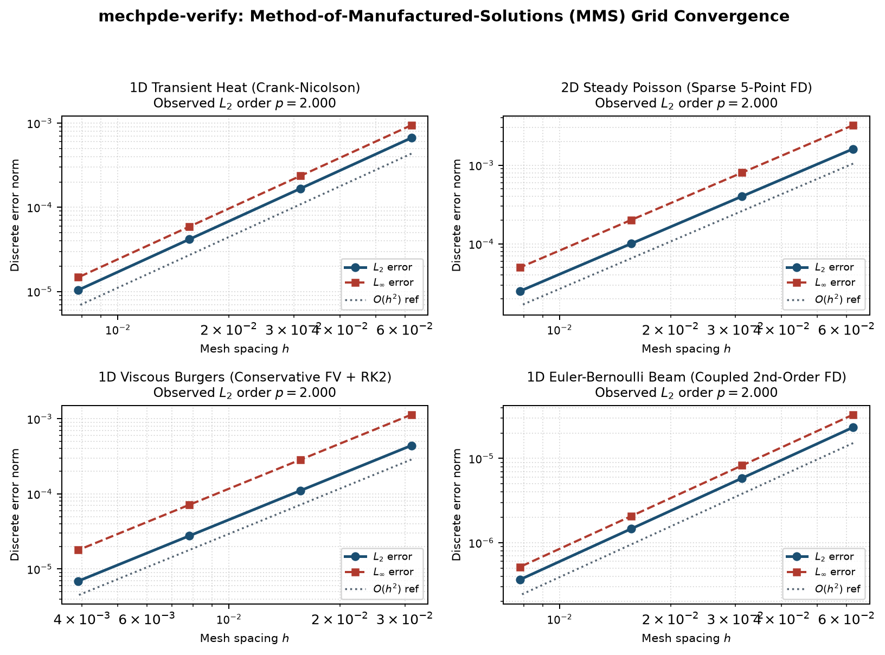

# mechpde-verify

[](https://github.com/spr027/mechpde-verify/actions/workflows/ci.yml)
[](LICENSE)
[](pyproject.toml)

**Reproducible finite-difference and finite-volume PDE solvers with Method of Manufactured Solutions (MMS) and discrete physics-residual verification for computational mechanics.**

`mechpde-verify` provides clean, deterministic reference solvers for canonical thermal, fluid, and structural partial differential equations paired with automated grid-refinement order-of-accuracy verification, Roache's Grid Convergence Index (GCI), and discrete stencil residual evaluators for verifying numerical solvers and physics-informed surrogate models.

## Implemented Solvers & Verification Tools

| Module | Governing Equation | Discretization | Verification |
| :--- | :--- | :--- | :--- |
| `heat1d` | $\frac{\partial u}{\partial t} = \alpha \frac{\partial^2 u}{\partial x^2} + f(x, t)$ | FTCS (with CFL guard), Backward Euler, Crank-Nicolson (`solve_banded`) | Analytical decay + $O(h^2 + \Delta t^2)$ MMS |
| `poisson2d` | $-\nabla \cdot (k \nabla u) = f(x, y)$ | 5-point central FD/FV via Kronecker-sum CSR (`spsolve`) | Manufactured 2D sinusoid + machine-precision residual |
| `burgers1d` | $\frac{\partial u}{\partial t} + \frac{\partial}{\partial x}(\frac{1}{2} u^2) = \nu \frac{\partial^2 u}{\partial x^2}$ | Conservative central flux + Heun RK2 (with diffusion CFL guard) | Exact Cole-Hopf traveling wave ($O(h^2)$) |
| `beam1d` | $EI \frac{d^4 w}{dx^4} = q(x)$ | Coupled 2nd-order moment/deflection decomposition | Analytical sinusoidal & uniform-load deflection |
| `verification.mms` | $p = \frac{\log(e_{h_1}/e_{h_2})}{\log(h_1/h_2)}$ | Discrete $L_1, L_2, L_\infty$ norms & Roache GCI | Automated multi-grid convergence studies |
| `verification.residuals` | $\mathcal{L}_h(u_h) - f_h$ | Discrete 1D Crank-Nicolson & 2D Poisson stencil residuals | Machine-precision operator check ($< 10^{-11}$) |

## Quickstart

Using [`uv`](https://docs.astral.sh/uv/):

```bash
git clone https://github.com/spr027/mechpde-verify.git
cd mechpde-verify
uv sync --extra dev
uv run pytest -v
uv run mechpde-verify
```

Or with `pip`:

```bash
pip install -e ".[dev]"
pytest -v
mechpde-verify --json-out paper/benchmark_results.json
```

## Reproducible Benchmark Results

Output of `uv run mechpde-verify`:

| Benchmark | Finest Mesh `h` | Finest `L2` Error | Finest `Linf` Error | Observed Order (`L2`) | Formal Order | Status |
| :--- | ---: | ---: | ---: | ---: | ---: | :---: |
| 1D Transient Heat (Crank-Nicolson) | `0.00781` | `1.043e-05` | `1.475e-05` | `2.000` | `2.0` | PASS |
| 2D Steady Poisson (Sparse 5-Point FD) | `0.00781` | `2.510e-05` | `5.020e-05` | `2.000` | `2.0` | PASS |
| 1D Viscous Burgers (Conservative FV + RK2) | `0.00391` | `6.918e-06` | `1.791e-05` | `2.000` | `2.0` | PASS |
| 1D Euler-Bernoulli Beam (Coupled 2nd-Order FD) | `0.00781` | `3.644e-07` | `5.154e-07` | `2.000` | `2.0` | PASS |



## Technical Report

A 2-page technical note detailing the governing equations, discretizations, and empirical convergence study is included at [`paper/mechpde_verify_technical_report.pdf`](paper/mechpde_verify_technical_report.pdf) and can be regenerated deterministically via:

```bash
uv run mechpde-verify --json-out paper/benchmark_results.json
uv run python paper/generate_report.py
```

## Citation

If you use `mechpde-verify` in your research, please cite [`CITATION.cff`](CITATION.cff):

```bibtex
@software{reddy2026mechpdeverify,
  author       = {Reddy, Sai Prasad},
  title        = {mechpde-verify: Reproducible PDE Solvers and Method-of-Manufactured-Solutions Verification Suite for Computational Mechanics},
  year         = {2026},
  version      = {0.1.0},
  url          = {https://github.com/spr027/mechpde-verify},
  license      = {MIT}
}
```

## License

MIT License — see [LICENSE](LICENSE).
